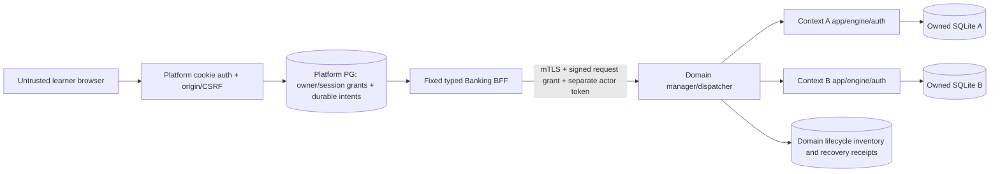
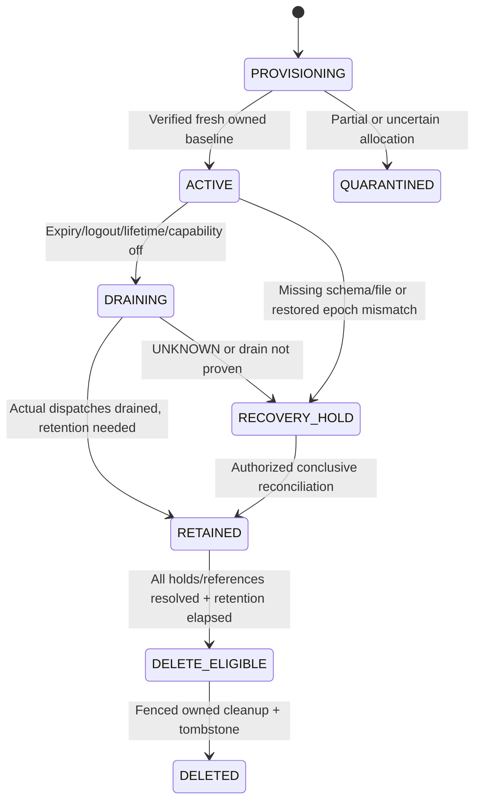

# Banking architecture decisions — U5-P

Status: **PROPOSED / NOT IMPLEMENTED**. Engineering objective: agree on an
isolated, recoverable banking boundary before B2/U5 code. Learning objective:
distinguish platform learners, synthetic bank actors, observed execution and
independently assessed financial evidence. This PR authorizes no runtime work.

The [implementation contract](BANKING_CROSS_REPO_IMPLEMENTATION_CONTRACT.md)
defines candidate wire behavior; the [decision checklist](BANKING_INTEGRATION_DECISION_CHECKLIST.md)
defines approval gates. UPIC-1.0 remains the authoritative **proposed blueprint**;
the deltas below require joint review, not an implicit upgrade or deployment.

## Verified provenance

Audit date: 2026-10-12. These are development baselines, not deployed versions.

| Repository / accepted branch | Exact SHA / evidence | Finding |
|---|---|---|
| `taodo/Data-QA-lab`, fetched `origin/feature/develop` | `37734f528d9afec26d2c155c60b00af2ab1d67a4` | U1 PR #34 merged; Task 20/20.1 and Task 21.1 present. Initial tree clean, branch `feature/u5p-banking-architecture-contract` created here. U2 PR #35 is not in this accepted base. |
| `taodo/MiniBanking`, remote `feature/develop` | `7a77ec579d7ff0edf2299d3755155573fee1ec15` | B1 PR #19 merged at this SHA; its base is the Task 9 merge below. Read through GitHub at this exact SHA; no domain checkout/fetch/modification. |
| MiniBanking Task 9 / PR #18 | merge `afc759817ba9756ea9f72a54cfebc661b29abb65`, source `ef6ab1ec6bf1d85eba6e36babc6527732a6265f3` | GitHub metadata independently confirms merged, 2026-10-12 08:50:39 UTC. |
| MiniBanking B1 / PR #19 | source `07067bc69be15fc1663a2e1e8788d009ddab6878`, merge as above | GitHub confirms merged, 2026-10-12 10:14:25 UTC. Docs remain proposals, not implemented B2–B5. |

U1's bank pin `2d7bf66` and Task 9 BLOCKED observations are historical, superseded
for this audit by the verified merges. They are not silently edited. U5-P does
not certify current production image, account count, banking capacity or runtime
test results. Automation-QA-Lab is outside this audit and unchanged.

All eight mandatory references were read:

- Platform: [Architecture](UNIFIED_PLATFORM_ARCHITECTURE.md),
  [UPIC-1.0](UNIFIED_PLATFORM_INTEGRATION_CONTRACT.md),
  [Roadmap](UNIFIED_PLATFORM_ROADMAP.md), [Test Strategy](UNIFIED_PLATFORM_TEST_STRATEGY.md).
- Bank, pinned accepted B1: [Readiness Audit](https://github.com/taodo/MiniBanking/blob/7a77ec579d7ff0edf2299d3755155573fee1ec15/docs/INTEGRATION_READINESS_AUDIT.md),
  [Isolation Design](https://github.com/taodo/MiniBanking/blob/7a77ec579d7ff0edf2299d3755155573fee1ec15/docs/BANKING_CONTEXT_ISOLATION_DESIGN.md),
  [Companion Contract](https://github.com/taodo/MiniBanking/blob/7a77ec579d7ff0edf2299d3755155573fee1ec15/docs/MINIBANKING_PLATFORM_INTEGRATION_CONTRACT.md),
  [B2–B5 Roadmap](https://github.com/taodo/MiniBanking/blob/7a77ec579d7ff0edf2299d3755155573fee1ec15/docs/MINIBANKING_INTEGRATION_ROADMAP.md).

Source cross-checks: [bank main/lifespan](https://github.com/taodo/MiniBanking/blob/7a77ec579d7ff0edf2299d3755155573fee1ec15/backend/main.py),
[Settings](https://github.com/taodo/MiniBanking/blob/7a77ec579d7ff0edf2299d3755155573fee1ec15/backend/config.py),
[actor auth](https://github.com/taodo/MiniBanking/blob/7a77ec579d7ff0edf2299d3755155573fee1ec15/backend/services/auth.py),
[transfers](https://github.com/taodo/MiniBanking/blob/7a77ec579d7ff0edf2299d3755155573fee1ec15/backend/services/transfers.py),
[strict transfer schemas](https://github.com/taodo/MiniBanking/blob/7a77ec579d7ff0edf2299d3755155573fee1ec15/backend/schemas/transfers.py),
platform [principal/writer](../backend/app/api/__init__.py) and [sessions/CSRF](../backend/app/accounts.py).
One bank file/app/token map exists today; no context service authentication or
BFF registry exists. Domain idempotency is durable, local UI intent memory is not.

## D1 — Option A and private service identity

**Recommend:** one domain-owned SQLite file, engine, app and AuthService scope
per practice context; a bounded manager/dispatcher owns their lifecycle. Platform
PostgreSQL owns the learner/session registry, authorized actor grants and pending
operations. No database consolidation, cross-repo branch merge or third backend.

The browser submits opaque context/actor selectors only. BFF resolves authority
from the current platform session, never a username, caller URL/path, raw actor
grant or runtime handle. Domain manager creates its own handle/path, authentic
synthetic baseline and durable ownership manifest. Routing has one runtime owner
per context. No round-robin workers with separate token maps; an unavailable
owner returns unavailable. Pilot starts with one dispatcher process; HA needs a
later fenced-lease design and test evidence.

**PROPOSED security profile:** mutually authenticated TLS with pinned private
service identities plus short-lived, per-request signed context grants (JWS,
ES256 allowlist). Platform holds the signing key; domain has verification keys
only. Grants are authorization attestations, not platform login/SSO tokens.
Peer identity, signature, issuer/audience, request digest, context epoch, actor,
scope, authorization revision and deadline must all match. Domain independently
enforces bank actor ownership after routing. No signature algorithm/key-fetch
choice from untrusted headers. PKI custody, key rotation and implementation
library/termination point require joint approval; no dependency is added here.
This follows [OWASP private REST guidance](https://cheatsheetseries.owasp.org/cheatsheets/REST_Security_Cheat_Sheet.html)
and [JWT verification BCP](https://www.rfc-editor.org/rfc/rfc8725).

File separation alone cannot prevent a dispatcher routing Alice to Bob's app,
using a role-only token cache, leaking history/evidence, or deleting an unowned
file. Registry authorization and domain validation are mandatory on every call.
App isolation is an application namespace, **not an OS sandbox**; a compromised
trusted domain process can affect its contexts. No uploaded/executed learner code.

Rejected for the initial slice: shared A/B/C database; tenant-column migration
(every query/FK/idempotency scope would need redesign); reusable warm pool (lease
and stale-state risk without measured need); per-visitor containers (unmeasured
operational overhead); private network/IP alone; shared HMAC authority that lets
the verifier mint platform grants. Capacity evidence may justify later changes.

## D2 — Ownership and resume

**Recommend:** shared-demo contexts bind to platform user **and the individual
authenticated session**, represented by a server-issued binding record. Two
browsers with one demo username cannot list, status-check, read, transfer, retry,
retrieve evidence or resume each other's contexts. Account quotas are budgets,
not permission to share state. Anonymous visitors get recorded/read-only content.

Named accounts initially remain session-bound. PROPOSED optional explicit rebind:
recent platform reauthentication (PROPOSED window5min if enabled), same named account, old binding revoked and
domain authorization-revision acknowledgement, then atomic binding transfer.
Keep original context/epoch and frozen actor/key/body, including UNKNOWN. No
username match, automatic rebind on login, parallel mutable binding or new-context
recovery. Product/security approval is required before enabling this option.

Every read/write/status/history/retry/evidence operation checks current session,
binding, context state and actor scope; foreign IDs return non-enumerating 404.
Logout/expiry revoke new admission and cached tokens, not financial history.
Already admitted writes may commit; cancellation/logout is not rollback proof.
Shared-demo logout cannot confer access to the old context on a later login.
Unresolved evidence remains for narrowly authorized operator reconciliation,
not a browser resume bypass. Lost session storage has no anonymous recovery.

Bank actor1/actor2 are synthetic roles within one context, not platform users.
Only granted role selection is allowed. Source-account ownership/participant
lookup remain domain rules; a different actor's recipient in the **same** context
is allowed, any cross-context recipient/routing is prohibited.

## D3 — Synthetic credentials and token lifecycle

**Recommend:** domain provisions unique per-context synthetic secrets using its
real PBKDF2/auth path; no copied public demo password as an isolation boundary.
A proposed private actor-login broker uses the existing `/auth/login` contract
internally. Only the token is returned to authorized BFF server memory; no bank
password is transferred to the browser or generic platform-token exchange.

Token cache key: domain context reference + immutable data epoch + actor; entry
also records runtime incarnation, expiry and authorization revision. No role-only
or username-only global cache. Single-flight renewal prevents login storms. On
expiry/401/restart/role revocation, discard the affected token; renew only after
fresh platform/grant authorization for the **original** actor. A fresh token does
not settle UNKNOWN. No fallback admin actor or automatic transfer retry.

Ordinary restart reopens the same verified file and preserves data epoch, clears
app-local tokens and changes runtime incarnation. Credentials remain protected
domain-side for authorized fresh login. Known bank defaults today: TTL 1800s,
capacity 10000; **PROPOSED integration defaults**: TTL 300s, capacity 8/context,
one login renewal/actor at a time, at most 2 login attempts/actor/minute. These
are new integration settings, not changes to standalone bank defaults. Selected
actor revocation/credential rotation is a B2/B3 extension, not an existing logout
API. Storage/key custody, redaction and revocation acknowledgement need tests.

## D4 — Conservative bounds and durable intent

All numbers in this table are **PROPOSED DEFAULTS, NOT MEASURED CAPACITY**. They
limit a small synthetic pilot and require B5 measurements before public approval.
Domain owns physical admission/storage; platform owns session/user/intent budgets.
Both reserve atomically before expensive work, including provisioning failures.

| Resource | PROPOSED DEFAULT | Rationale / exhaustion rule |
|---|---|---|
| Active contexts | 1/session, 3/platform user, 20/global | Bound file/engine/hash work and shared-demo load; provisioning/draining occupy slots. No eviction. |
| All context inventory including retained holds | 100/global | UNKNOWN cannot grow forever unnoticed; at cap stop allocations, alert operator, never auto-delete holds. |
| Creation | 1/session/5min; 2/user/10min; 6/global/min | Rolling windows deter expensive provisioning; 429 for caller budgets, 503 global capacity. Failed attempts count. |
| Provisioning | 2 concurrent, queue 4, queue wait 2s, work deadline 30s | Bound PBKDF2/initialization; timed-out allocation remains tracked, same allocation intent retrieves status. |
| Requests | 4 active/context, 16/global; max 1 transfer dispatch/context | Separate read concurrency from serialized write admission; duplicate submits coalesce, no second posting attempt. |
| Queue | 2/context, 32/global, max wait 200ms | Bounded backpressure; reject before dispatch when full. |
| User requests / retries | 30/session/min; 6 transfer submits/session/min; 3 attempts/intent/5min, 10 lifetime | No automatic transfer retry; retry budget includes failures. Exhaustion preserves operation and permits authorized read-only recovery. |
| Context idle TTL / lifetime | 30min idle / 4h absolute | Expiry closes new writes; caller reads/polls do not keep it alive indefinitely. Authorized practice activity advances idle timestamp. |
| Storage | 16MiB/context including DB/WAL/sidecars; 2GiB global including inventory/evidence/logs | Reserve headroom before writes; storage failure after submission may be UNKNOWN. No silent truncation. |
| Operation / evidence bounds | 100 intents/context; 500 observations/context; 2MiB sanitized evidence/context | Fail admission at limit; record INCOMPLETE if collection fails. Existing 1MiB bank import policy remains unchanged. |
| Platform Banking registry | 10000 operations / 64MiB global, subject to smaller existing demo budgets | Separate bound on new PG control records; no eviction/truncation of referenced or UNKNOWN records. |
| HTTP bounds | 16KiB request, 256KiB response; accounts max100; history limit1–100/offset0–10000 | Bound parsing/row growth; do not trim a referenced page/run to fit. Oversize upstream is a contract error. |
| Time budgets | connect2s/read5s/total8s per dispatch; SQLite wait1000ms | Outer deadline exceeds current SQLite wait; timeout after possible submission stays UNKNOWN. |
| Drain | 15s before retained recovery hold | Deadline is not proof all writes rolled back; close only after actual handles/writes drain. |
| Resolved context / intent retention | >=7 days after closure/settlement | Keep original keys/replay scope through every allowed retry; deletion needs no unresolved/referenced obligation. |
| Sanitized evidence/audit retention | 30 days | Bounded pilot diagnosis; later learner progress may require longer retained evidence, a separate D7 decision. |
| UNKNOWN retention | No automatic TTL deletion; review alert at24h | Hold until conclusive reconciliation and approved disposition; global storage/inventory caps stop new work if needed. |

Persist browser `client_intent_id` before acceptance in session-namespaced local
storage; persist its immutable mapping server-side before any upstream submit.
Unique binding+intent maps to one context/epoch/actor/key/body, not merely a body
hash. Repeated identical amounts may be deliberate new transfers. Refresh/response
loss retrieves the same operation via intent; changed context/actor/body conflicts.
No new intent/key/context replaces an UNKNOWN. Browser storage holds no bank token,
password or raw key. Protocol and retention are specified in the companion contract.
Block replacement mutable allocation for a binding with UNKNOWN, and for a named
account across rebinds. Other shared-demo browser bindings remain independent;
a later demo login cannot claim the prior session's operation as a new retry.

## D5 — UNKNOWN, expiry, restart and safe cleanup

**Recommend:** durable two-phase intent acceptance and explicit submission;
persist SUBMITTING before dispatch. Domain also records admitted request/receipt
identity before calling the context app. A crash in either boundary is conservatively
UNKNOWN; no distributed exactly-once guarantee is claimed. Bank idempotency applies
only in the original DB/actor/operation/key scope.

Valid 201/new or 200/replay confirms a matching committed result, not QA PASS.
An authenticated first-attempt 409/422 rejection is distinct from UNKNOWN. Timeout,
500, 401, malformed success or loss of either response never proves no commit.
A later rejected attempt cannot erase earlier uncertainty. In ACTIVE state an
explicit retry may use original actor/key/body after reauthorization; no probe or
different payload is accepted as recovery. In DRAINING/RETAINED, only read-only
reconciliation is allowed: the existing POST `/transfers` cannot guarantee
replay-only behavior when its key is absent, so it must not be called there.

Domain-owned recovery observer checks drained receipts and consistent independent
state; MATCHING_COMMIT, NO_COMMIT_PROVEN or INCONCLUSIVE has explicit provenance.
No row at one instant is not proof while a write is in flight. BFF never reads
bank SQL directly. Missing file/schema/receipt or an older restored snapshot means
hold/inconclusive, not new-key retry. A synthetic operator may settle a proven
uncommitted operation without resubmitting it; disposition remains in evidence.

Normal restart preserves epoch; restore/replacement creates a new data epoch and
fences **all old operations**, without translating them to the new epoch. Restore
requires matched platform intent/domain inventory/SQLite backup checkpoints and
independent reconciliation before writes resume. An old snapshot may have lost
committed idempotency records. Use a [supported consistent SQLite backup](https://www.sqlite.org/backup.html),
not an arbitrary live-file copy. Code rollback never rewinds money/state.

Cleanup requires a domain ownership manifest, canonical private-root containment,
no symlink/junction traversal, lifecycle lease/fence, actual drain, cleared tokens,
closed engines/handles, platform reference/hold acknowledgement and elapsed
retention. It deletes only explicitly disposable manager-created files and records
a tombstone preventing handle reuse. Unknown/unregistered/retained files are never
swept or reset. Cleanup crashes resume the same fenced deletion, not reallocation.

## D6 — Exact integer wire contract

**Recommend:** canonical ASCII decimal strings for every Banking amount/balance
at the BFF/browser boundary; MiniBanking retains StrictInt signed64-bit domain API.
Accept amount `[1-9][0-9]{0,18}` only, then exact range1..9223372036854775807;
balances allow `0` too. No float/Number/parseInt conversion, scientific notation,
sign, whitespace, leading zero or coercion. A digit-pattern check alone is not
an overflow check. Server maps exactly to Python int for the fixed domain request.

Upstream integers must be type/range checked before conversion to strings,
including nested history. Bool/float/malformed currency or out-of-range response
is a contract error, never rounded evidence. Separate configured transfer limit,
funds and recipient overflow remain domain409 rules, not schema range errors.
Values beyond JS safe integer still work losslessly in approved integration tests;
domain max-int inputs may legitimately fail a business limit. This avoids the
[JSON number interoperability boundary](https://www.rfc-editor.org/rfc/rfc8259#section-6).
Existing Data QA NUMERIC/Decimal/SQL behavior remains untouched.

## D7 — Learning evidence and progress (later gate)

MiniBanking owns banking business expectations, challenge IDs and producer
observations; Data QA owns reviewed ENG/VIE presentation, versioned rubric,
assessment result and learner progress. Existing eight IDs remain stable:
auth-ownership, exact-deltas, replay-new, conflict-preservation, lookup-history,
missing-side, rollback-retry, loss-durable. Task 9 C01–C10 are not ten extra UI IDs.
No automatic localStorage migration or HTTP2xx completion. Tutorial persistence
and existing 36 executable lab semantics remain unchanged.

Proposed evidence separates LIVE/RECORDED/IMPORTED provenance, exact producer
SHA/API/fixture/content/rubric versions, context/epoch/operation, UTC observations,
execution outcome, assessment and completeness. Independent assertions check
per-account deltas, exactly paired ledger sides, references, FK/reconciliation
and durable replay; total equality alone is insufficient. A file's PASS/hash is
not authenticated truth. Free-text answers are saved/self-reviewed if later scoped,
never claimed semantically graded. Raw keys/tokens/credentials/SQLite files stay
private; snapshots are bounded and sanitized, no silent removal of references.

D7 is deferred to U3/U7/U9: approve bilingual content, trusted provenance/rubric,
assessment authority and retention/privacy before claiming assessed completion.
U5/U6 may implement operations/evidence metadata without progress or grading.

## Threat ownership and public blockers

| Threat | Required mitigation / accountable owner |
|---|---|
| Shared-login IDOR / confused deputy | Session-bound registry and checks on every selector; Data QA U5/U6, domain B2 grant validation |
| Token mixing / forged grant / stale epoch | mTLS+fixed JWS profile, actor ownership, incarnation cache invalidation; B2/B3 + U5 |
| SSRF / arbitrary HTTP / secret leakage | Fixed operation enum/URL, no redirects, whitelist schemas/headers/log fields; U6 + B3 |
| New-key duplicate after loss | Durable binding/intent/operation and domain receipts, frozen original recovery; U5 + B2/B4 |
| Path/cleanup races / restored references | Owned-root checks, fences/actual drain/tombstones/checkpoint reconciliation; B2/B5 |
| Resource exhaustion | Atomic budgets, reservations, bounded queues/storage and feature-off; B2/B3 + U5, measured B5 |
| Rounded money / false progress | Exact string adapter and independent oracles, provenance/rubric gate; U6/B4, U7/U9 |
| Trusted domain process/signing-key compromise | Private service isolation/least privilege, key custody/rotation and revoke/off runbook; joint operations/security owners |

Joint questions still OPEN: PKI/signing-key custody/library/rotation/revocation;
named learner rebind and orphan UNKNOWN operator powers; numeric budgets and
disk reservations/hold escalation; matched backup/restore reconciliation; accepted
contract pins; D7 evidence access/retention/rubric. No numeric proposal is approval.
Public live Banking is **BLOCKED** until D1–D6, B2–B5/U5/U6 negative tests and
separate release approvals close. D7 additionally blocks assessed challenges/progress.
Local pilot is CONDITIONAL on explicit scope/security approval and disposable state.

## U5-P verification boundary

EXECUTED: fetch/ref/status checks, exact GitHub merge metadata, eight-document
inspection, pinned route/schema/auth/transfer/oracle/challenge source audit,
lightweight Markdown/source/consistency/scope checks and `git diff --check`.
Commands/results and final HEAD are recorded in the PR and checklist checkpoint.
NOT RUN: bank runtime/OpenAPI server, pytest/Newman/SQL queries, frontend build,
full local suites, DB initialization/reset, deployment/tunnel or public probes.
Historical B1/Task 9 results are attributed references, not U5-P executions.
Only the three Markdown deliverables are committed; no domain, runtime, schema,
configuration, dependency, secret or deployed data changes.
