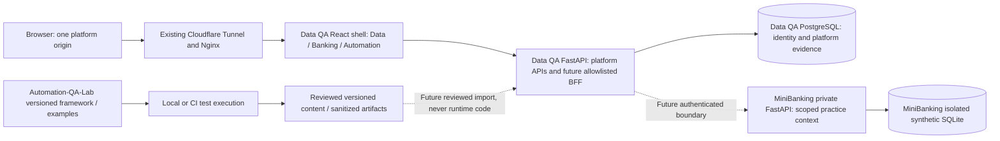

# Unified QA Learning Platform — U1 architecture audit

Status: architecture proposal for independent review, not implementation/deployment approval. Audit date: 2026-10-12. Engineering objective: one coherent platform with explicit domain, authentication and data boundaries. Learning objective: learners can find Data, Banking and Automation practice without confusing an execution result, recorded evidence or self-check with verified completion.

The authoritative integration requirements are in [Integration Contract](UNIFIED_PLATFORM_INTEGRATION_CONTRACT.md). See [Roadmap](UNIFIED_PLATFORM_ROADMAP.md) and [Test Strategy](UNIFIED_PLATFORM_TEST_STRATEGY.md). `VERIFIED` means inspected source/metadata or the specifically recorded HTTP observation; `PROPOSED` means future work; `UNRESOLVED` means an approval gate, not permission to guess.

## 1. Repository and deployment provenance

| Repository/state | Exact audited revision | Finding |
|---|---|---|
| `taodo/Data-QA-lab`, fetched `origin/feature/develop` | `e4274a4e0624d7da085e34963c06676f6c19f74f` | PR #33 merged; includes Task 20, 20.1 and 21.1. U1 branch `feature/u1-platform-architecture` starts here; initial worktree clean. |
| Platform `origin/main` | `ad3f88bd430de9b4ff8d33307435dc39eb2949f7` | Contains Task 20; ancestor checks show Task 20.1 (`f85a2ef`) and Task 21.1 (`0397044`) absent. Main is a release branch, not proof of deployed image SHA. |
| `taodo/MiniBanking`, accepted remote `feature/develop` | `2d7bf660611cbfe853489b9014f0453acbfcf1c8` | Merge PR #16, Task 7+8. Read this Git object without switching or fetching into the domain checkout. Remote refs confirmed by `git ls-remote`. |
| MiniBanking local/remote Task 9 branch | `27187cb5fd54e4dcfcd139a1ab849c1c2e7c5dd3` | PR #18 open/draft/unmerged, base `2d7bf66`. Issue #17 reports BLOCKED local HIGH regression evidence; approval pending. Six-file diff adds concurrency runner/tests/guide, not banking API changes. Not an accepted integration dependency. |
| MiniBanking remote main | `65e939d8dfb2e2cf5f5fc9644bd785db91a2fa21` | Recorded separately; not the chosen accepted banking integration baseline. |
| `taodo/Automation-QA-Lab`, main/HEAD | `b13353265707223b83b46855a55695655398775b` | Initial commit contains only `.gitattributes`. No framework, service, requirements or develop branch verified. README fetch 404; initial-commit file inventory explains it. No initialization/modification performed. |

Pinned domain references: [MiniBanking accepted source](https://github.com/taodo/MiniBanking/tree/2d7bf660611cbfe853489b9014f0453acbfcf1c8), [Task 9 PR #18](https://github.com/taodo/MiniBanking/pull/18), [Task 9 status/evidence](https://github.com/taodo/MiniBanking/issues/17), [Automation initial commit](https://github.com/taodo/Automation-QA-Lab/commit/b13353265707223b83b46855a55695655398775b). Task reports are attributed evidence, not independently executed tests in U1.

Anonymous GET observation at **2026-10-12 07:28:32 UTC / 14:28:32 Asia/Bangkok**:

| URL on `https://data-qa-lab.store` | Observed |
|---|---|
| `/` | 200, Data QA Lab HTML, `Server: cloudflare` |
| `/api/courses?language=ENG` | 200, nine existing course IDs, no `learning_kind`, `Cache-Control: no-store` |
| `/api/lessons?language=ENG` | 200, 36 lessons, no-store |
| `/api/auth/config` | 200, `demo_mode: true`, no-store |
| `/api/courses/ai-test-automation` | 404 |

The public API is consistent with a pre-Task-21.1 catalog; merged develop functionality is **not live there at observation time**. Live build SHA, Task 20.1 visual behavior, tunnel configuration and actual retained-account count were not independently inspected. No auth/login/credentials endpoint, environment secret, database or deployment control was read/changed. The operator reports 15 retained demo accounts; source caps public listings at ten, which is not a total-account census. Preserve all retained identities; do not reprovision to reconcile that count.

## 2. Verified platform frontend

- [App.tsx](../frontend/src/App.tsx) owns the shared header, Subjects, breadcrumbs, route dispatch and `dqa-language`: first visit/invalid preference ENG; explicit ENG/VIE persists. [router.tsx](../frontend/src/router.tsx) wraps History push/replace/popstate, validates `safeNext`; [spa.py](../backend/app/api/spa.py) explicitly allowlists refresh routes.
- [LandingPage.tsx](../frontend/src/LandingPage.tsx) is currently Data QA-focused. [CoursePages.tsx](../frontend/src/CoursePages.tsx) provides public subject/library/course pages; `/courses` contains ten courses on develop. Its executable proof counters deliberately remain nine/36. Subject is not a track.
- [Theme.tsx](../frontend/src/Theme.tsx), [theme-init.js](../frontend/public/theme-init.js) and [theme.css](../frontend/src/theme.css) apply persistent `dqa-theme`, Dark default/invalid fallback, document-level paired semantic tokens and theme storage synchronization. Language preferences are independently stored; not a server profile or shared-domain SSO setting.
- [Auth.tsx](../frontend/src/Auth.tsx) gates executable lessons, My Learning/history/pipeline/account; unauthenticated users see an explicit login link with safe return URL. Demo signup stays Coming Soon. [client.ts](../frontend/src/client.ts) sends same-origin credentials, CSRF/account headers and guards stale account responses/drafts.
- [LessonPlayer.tsx](../frontend/src/LessonPlayer.tsx) handles executable evidence/editor/session/hint/reveal/submission behavior. [TutorialPages.tsx](../frontend/src/TutorialPages.tsx) is a separate public renderer: local code/prompt copy, no session/grading/progress writes. Task 21.1 remains in this repository; do not recreate/remove it when Automation bootstraps.
- [SubjectsMenu.tsx](../frontend/src/SubjectsMenu.tsx), [AccountMenu.tsx](../frontend/src/AccountMenu.tsx), [DisclosureChevron.tsx](../frontend/src/DisclosureChevron.tsx) preserve native disclosure semantics, Escape/outside/focus handling and mutual exclusion. [academy.css](../frontend/src/academy.css) supplies the unified search ring and scoped shared component treatment.

Current route audit found a concrete U2 prerequisite: unmatched `/learn/*` currently renders a loading state, while refresh allowlisting accepts only legacy `/learn/lab_*`. None of the proposed `/learn/data|banking|automation` routes is implemented. New exact track matches must precede the legacy fallback; unknown `/learn/*` must end in NotFound rather than indefinite loading.

## 3. Verified platform backend and data

| Area | Verified boundary and source |
|---|---|
| Catalog | [courses.py](../backend/app/courses.py), [lessons.py](../backend/app/learning/lessons.py): SQL 13, ETL 5, API 4, Fabric 3, ADF 3, OneLake 2, Azure 2, Databricks 2, Synapse 2 = 36 executable labs. Course IDs remain immutable. |
| Tutorial | [tutorials.py](../backend/app/learning/tutorials.py), [manifest](../backend/app/learning/automation_curriculum.json), [types.ts](../frontend/src/types.ts): `ai-test-automation`, ten modules/30 metadata entries, only `m01-l01` available in ENG/VIE. Planned API 409, missing 404, invalid language 422; tutorial enrollment 409. No tutorial persistence. |
| HTTP/access | [API module](../backend/app/api/__init__.py): public catalog/content; principal/writer/owned checks on private data and mutations. Shared sample pipeline runs explicitly readable; no shared mutation bypass. |
| Identity | [accounts.py](../backend/app/accounts.py): Argon2 accounts, PostgreSQL hashed opaque session tokens, seven-day expiry, HttpOnly SameSite=Lax cookie, Secure on trusted HTTPS, per-session CSRF. X-DQA-Account detects changed identity; it is not an authentication credential. |
| Persistence | [schema.sql](../backend/app/persistence/schema.sql): platform accounts/session/enrollment, owner-scoped lab sessions/queries/submissions and run/fault evidence. [service.py](../backend/app/learning/service.py) owns executable completion semantics; a query execution SUCCESS is not a DQ PASS. |
| Pipelines/exercises | `pipeline/` source→bronze→silver→gold/target stages; [etl.py](../backend/app/learning/etl.py), [http_exercises.py](../backend/app/learning/http_exercises.py), [cloud.py](../backend/app/learning/cloud.py), [foundations.py](../backend/app/learning/foundations.py). Cloud is bounded local SIMULATED/IMPORTED evidence, not live provider verification. |
| Restricted SQL | [sql_runtime.py](../backend/app/learning/sql_runtime.py), [contracts.py](../backend/app/learning/contracts.py): allowlisted session schemas/SELECT grants/read-only transactions; default 2s statement timeout, 3s watchdog, 100 rows, 20 columns/64KiB bounds. No arbitrary banking SQL passthrough. |
| Portable evidence | [cloud_contracts.py](../backend/app/learning/cloud_contracts.py) and foundations contracts keep explicit limits/context, referenced runs and local mutation revisions. Imported evidence cannot redefine clean/fault grading truth. |
| Public showcase | [demo.py](../backend/app/demo.py), [public_demo.py](../backend/app/public_demo.py): separate demo DB guard, session/account/write/storage caps, public-shared disclosure, password lock and operator-only provisioning. Preserve budgets and retained history; new track operations cannot bypass them. |

Existing APIs and proposed boundaries are enumerated in the [authoritative contract](UNIFIED_PLATFORM_INTEGRATION_CONTRACT.md#3-existing-verified-api-boundaries).

## 4. MiniBanking accepted-source audit

Source references in this section are pinned to `2d7bf66`; Task 9's working branch is not silently substituted.

- [main.py](https://github.com/taodo/MiniBanking/blob/2d7bf660611cbfe853489b9014f0453acbfcf1c8/backend/main.py): modular FastAPI 0.1.0, explicit Settings, lifespan verifies existing SQLite schema; missing/weak schema fails with initialization/upgrade guidance, no startup seed/reset. `/health` is process readiness, not continuous DB verification. OpenAPI contract derives from decorators and response models; no runtime server/DB was started in U1.
- [auth service](https://github.com/taodo/MiniBanking/blob/2d7bf660611cbfe853489b9014f0453acbfcf1c8/backend/services/auth.py) and [dependencies](https://github.com/taodo/MiniBanking/blob/2d7bf660611cbfe853489b9014f0453acbfcf1c8/backend/api/dependencies.py): salted PBKDF2, app-local hash-indexed opaque Bearer tokens, monotonic TTL default 1800s/capacity 10,000. Restart invalidates tokens. No platform-cookie verifier, shared SSO or logout endpoint. Auth store cannot simply be load-balanced across workers.
- [transfer service](https://github.com/taodo/MiniBanking/blob/2d7bf660611cbfe853489b9014f0453acbfcf1c8/backend/services/transfers.py), [schemas](https://github.com/taodo/MiniBanking/blob/2d7bf660611cbfe853489b9014f0453acbfcf1c8/backend/schemas/transfers.py): strict positive INTEGER VND, no fees/overdraft, default single-transfer cap 2,000,000; signed-64-bit/recipient overflow checks. `BEGIN IMMEDIATE`, scoped idempotency (user + transfer-create + key/semantic fingerprint), one transaction for debit/credit/transfer/two ledger sides/reference. Same key/body replay 200 preserves original 201 result; altered body 409, exhausted bounded SQLite contention 503. Authenticate/authorize before accessing replay; ownership/read visibility still applies.
- [database.py](https://github.com/taodo/MiniBanking/blob/2d7bf660611cbfe853489b9014f0453acbfcf1c8/backend/db/database.py), [config.py](https://github.com/taodo/MiniBanking/blob/2d7bf660611cbfe853489b9014f0453acbfcf1c8/backend/config.py): independent file-backed SQLite and SQLAlchemy; FK/nonnegative/type/uniqueness/schema checks, explicit known-schema upgrade. Defaults are local practice configuration, not public tenancy. Keep SQLite files outside public/static trees.
- [learning.py](https://github.com/taodo/MiniBanking/blob/2d7bf660611cbfe853489b9014f0453acbfcf1c8/backend/learning.py), [app.mjs](https://github.com/taodo/MiniBanking/blob/2d7bf660611cbfe853489b9014f0453acbfcf1c8/web/learn/app.mjs): separate static Vietnamese UI at `/learn/`, eight challenges, live same-origin API calls, token/operation key/body in memory, uncertain outcome blocks new operation. LocalStorage `minibanking-learning-progress-v1` is manually marked device state, not platform identity/grading. CSP `frame-ancestors 'none'` also rules out casually embedding its existing page as an iframe.
- [evidence.mjs](https://github.com/taodo/MiniBanking/blob/2d7bf660611cbfe853489b9014f0453acbfcf1c8/web/learn/evidence.mjs): explicit local file import, 1MiB limit, depth/node/row bounds, whitelist/redaction of secret-bearing fields, supporting API/SQL snapshots; claimed file PASS is not authenticated evidence. Existing shapes cover Task 5/6, not an implemented Task 9 integration.
- [verify_sql.py](https://github.com/taodo/MiniBanking/blob/2d7bf660611cbfe853489b9014f0453acbfcf1c8/scripts/verify_sql.py), [Postman collection](https://github.com/taodo/MiniBanking/blob/2d7bf660611cbfe853489b9014f0453acbfcf1c8/postman/MiniBanking.postman_collection.json), [run_postman.py](https://github.com/taodo/MiniBanking/blob/2d7bf660611cbfe853489b9014f0453acbfcf1c8/scripts/run_postman.py): learner API workflows, fresh runner-owned DB/localhost server, Newman + independent read-only SQL invariants, sanitized artifacts. Fault CLI uses private test seams, not HTTP controls.
- [regression.yml](https://github.com/taodo/MiniBanking/blob/2d7bf660611cbfe853489b9014f0453acbfcf1c8/.github/workflows/regression.yml): full Linux pytest/real HTTP smoke/Newman+SQL; Windows readiness/SQL portability, minimal permissions/timeouts. U1 did not rerun them or certify the current domain release.

Integration readiness: suitable *local domain contract*, not an approved public multi-learner service. No existing public tenancy/isolation, origin/host/proxy contract, login throttling or cross-platform identity mapping was demonstrated in accepted main app source. Defaults A/B/C and shared mock roles would collide if exposed as one shared bank DB. Do not expose it with a generic reverse-proxy prefix.

## 5. Target topology — PROPOSED, not live



Data QA owns the browser application, origin, identity and shared learning navigation. MiniBanking owns banking logic and SQLite; an adapter must call its API, never reimplement transfers or query its tables as the runtime business path. Automation-QA-Lab owns future frameworks/examples and CI execution; Data QA keeps tutorial presentation and reviewed bilingual content. **Three repositories do not imply three web backends.** Initially there are the two existing FastAPI services; Automation has no deployed service. An execution backend is a separate later threat-model/approval decision.

Homepage: three first-class cards → `/learn/data`, `/learn/banking`, `/learn/automation`. Data landing reuses existing Data QA presentation and nine executable course links. Banking initially explains mock domain/challenges and unavailable execution honestly. Automation links existing `ai-test-automation` without duplicating its renderer. `/courses` stays the public all-course catalog; current course/subject IDs and saved URLs remain stable.

Use platform React views for future banking presentation, not MiniBanking's independent static UI/CSS or an iframe. Reuse versioned domain content only after ENG/VIE authorship/contract review. Inherit [Task 20 MASTER](../design-system/data-qa-lab/MASTER.md) and the mandatory UI contract in [Integration Contract](UNIFIED_PLATFORM_INTEGRATION_CONTRACT.md#2-ownership-and-ui-inheritance).

## 6. Routing, identity, security and progress decisions

The [route matrix](UNIFIED_PLATFORM_INTEGRATION_CONTRACT.md#5-route-and-track-compatibility-contract) specifies current versus proposed behavior for direct URLs, reload, history, auth returns and aliases. Add exact matches to React **and** SPA fallback together; never replace legacy course paths with mandatory track-prefixed paths. No bulk rewrite of saved history/course IDs.

Recommendation: a narrowly allowlisted Banking BFF inside existing Data QA backend. It validates platform session/CSRF and context ownership, then resolves a separately issued bank role/token for one isolated synthetic context. This is not SSO: no platform cookie/header/token is forwarded or accepted by MiniBanking. Provisioning/lifecycle remain private domain/operator responsibilities until explicitly approved. Public bank writes stay disabled until context isolation, quotas, retry/recovery and threat review pass. Initial U2 needs none of these writes.

Reject a generic proxy, browser-supplied upstream URL, global shared-bank DB and silent platform→bank account equivalence. Direct localhost MiniBanking practice remains a separate domain workflow. The [threat table](UNIFIED_PLATFORM_INTEGRATION_CONTRACT.md#6-authentication-data-isolation-and-threat-analysis) covers cookie/token confusion, IDOR, SSRF, CSRF, token expiry/restart, uncertain transfers, imports, shared accounts and public code execution.

Progress owners: existing Data QA account-scoped attempts/completion in PostgreSQL; Automation tutorial progress absent; MiniBanking local self-marked progress stays separate/untrusted; future platform-owned Banking evidence/completion must distinguish self-report, observed execution and independently assessed requirement coverage. Public-shared demo identities are not unique humans; do not promise per-visitor privacy under the same shared login. No migration of browser progress or bank users into platform users in U1.

## 7. Deployment and rollback

VERIFIED local platform [Compose](../docker-compose.yml): app loopback 8000, PostgreSQL loopback 5432, retained bind-mounted data. Port 8000 may already serve QA Sentinel on this operator's machine; future unified verification must use reserved nonconflicting ports/test overrides, not stop that unrelated service.

VERIFIED demo [Compose](../docker-compose.demo.yml): separate `data_qa_demo` database/bind data; Nginx loopback 8001→internal app 8000, fixed trusted proxy peer, no public PostgreSQL port. [Nginx config](../scripts/demo-nginx.conf) forwards exact Host/sanitized scheme, strips forwarded host/IP authority, applies body/time/rate bounds. [web_security.py](../backend/app/web_security.py) enforces exact hosts, trusted-peer scheme and public HTTPS; API origin/CSRF checks remain. [Named Tunnel runbook](DEMO_ONLINE.md) routes the existing connector to loopback 8001; no tunnel secrets/config inspected or changed in U1. [Official Cloudflare overview](https://developers.cloudflare.com/cloudflare-one/networks/connectors/cloudflare-tunnel/) describes an outbound connector; it does not establish application identity/tenancy controls.

PROPOSED local unified mode: same React/FastAPI platform; banking on private/loopback nonconflicting port (candidate 8002, reserve/check first), with newly allocated disposable SQLite context paths. Automation runs learner/CI-owned environments on D, no listening service. Ports/settings are proposals, not implemented Compose/environment keys.

PROPOSED public mode: keep one existing domain/Tunnel→Nginx→platform origin; Banking only private-network allowlisted BFF upstream, no raw bank endpoint/static/DB publication. Automation offers approved static content/artifacts, no public runner. Retained PostgreSQL and practice SQLite stay separate. Future context provisioning uses fresh owned state; never resets a retained bank or demo DB. Storage TTL/cleanup may delete only explicitly disposable context state under approved ownership/retention policy, never shared learner evidence.

Release rollback: record approved platform + bank/framework/content revisions; integration feature flags default off. On bank failure disable the Banking adapter/action entry points, preserve unknown-operation evidence and original key/body, keep landing/content and Data QA/tutorial browsing working. Never turn timeout into a failed/complete transfer or send a new key automatically. Reject missing/incompatible Automation package and keep the last approved manifest, including M01.L01. Revert platform image/assets to a known data-schema-compatible release after approval, preserving databases/accounts; a code rollback never implies data rollback. No U1 deployment, initialization, reseed, migration, volume removal or secret rotation.

## 8. Open decisions and limits

1. Approve isolation model/capacity/lifetime for public Banking contexts before U5/U6; accepted MiniBanking API has no tenant/context provisioning contract. Choose app+SQLite-per-context versus a separately approved tenant-aware domain change; do not assert either exists.
2. Decide whether public shared demo identities may use only recorded evidence or ephemeral context scoped additionally to a browser/platform session. Shared username alone is insufficient per-visitor isolation.
3. Approve future evidence provenance/completion rubric and retention; imported/self-reported evidence remains untrusted. Separate execution status, quality/assessment status and completeness.
4. Obtain authoritative Task 21.2–21.5/Task 22 scopes. Repository contains Task 21.1 only; the roadmap gives explicitly provisional integration mapping, not fabricated approved requirements.
5. Automation bootstrap/version/maintainer/release license and checksum policy require a domain task. No framework or synchronization is present.
6. Confirm exact deployed image/main release and inventory of retained accounts privately at a future authorized release gate; anonymous catalog observation cannot identify an image SHA or user count.
7. Task 9 remains domain BLOCKED; do not absorb its code or waive its gates. U1 can be review-ready on the accepted Task 7+8 baseline while execution integration remains gated.

U1 independently verified Git refs, source contracts/catalog counts, Task 9 PR metadata and anonymous public responses. Runtime MiniBanking OpenAPI generation, HTTP/Newman/concurrency tests, banking SQLite contents, platform PostgreSQL contents, tunnel settings, real-device accessibility and deployment provenance were **NOT RUN / NOT INSPECTED**. No full suite required for these documentation-only changes.

## 9. U1 verification checkpoint

Lightweight audit helper (ignored, retained on D at `data/generated/u1/check_docs.py`): **PASS** — four documents, 83 relative links/heading references, 16 pinned MiniBanking Git objects and all 37 declared platform API routes represented; zero errors. Initial inventory check found ambiguous tutorial/fault-reset shorthand; corrected to exact declared paths and reran successfully. External source refs were checked against accepted Git objects/metadata, not runtime service execution.

Commands actually used (PowerShell; no commands initialize or query a database):

```powershell
Set-Location D:\Data-QA-Lab
git status --short --branch
git fetch origin
git log -4 --oneline origin/feature/develop
git rev-parse origin/feature/develop origin/main
git merge-base --is-ancestor 0397044d912fc2432b04950264af08500444ae15 origin/feature/develop
git ls-remote https://github.com/taodo/MiniBanking.git refs/heads/feature/develop refs/heads/feature/task-9-concurrency-lab refs/heads/main
git -C D:\MiniBanking show 2d7bf660611cbfe853489b9014f0453acbfcf1c8:backend/main.py
git -C D:\MiniBanking status --short --branch
git ls-remote https://github.com/taodo/Automation-QA-Lab.git
$env:PYTHONUTF8='1'
# Local audit helpers are not product code and are not shipped in the PR.
.venv\Scripts\python.exe data/generated/u1/check_docs.py
.venv\Scripts\python.exe data/generated/u1_public_audit.py
git diff --check
```

Git diff must contain exactly these four new Markdown deliverables; final committed whitespace/scope and remote SHA verification are recorded in the PR/handoff. No application changes, build/full suite, domain mutation, credentials inspection, database/volume operations, deployment or U2 start. U1 blueprint is **READY_FOR_REVIEW**, while the explicitly identified execution/specification/release decisions remain future gates.
